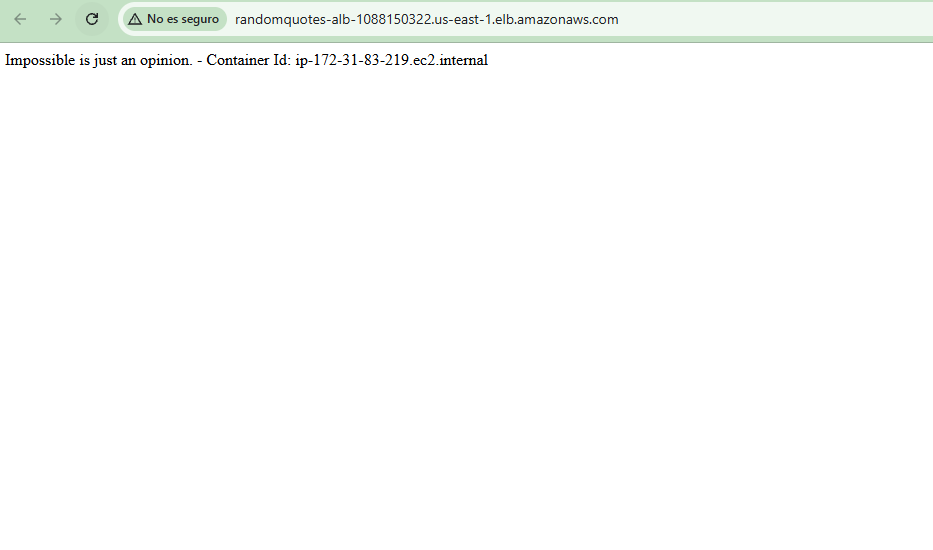
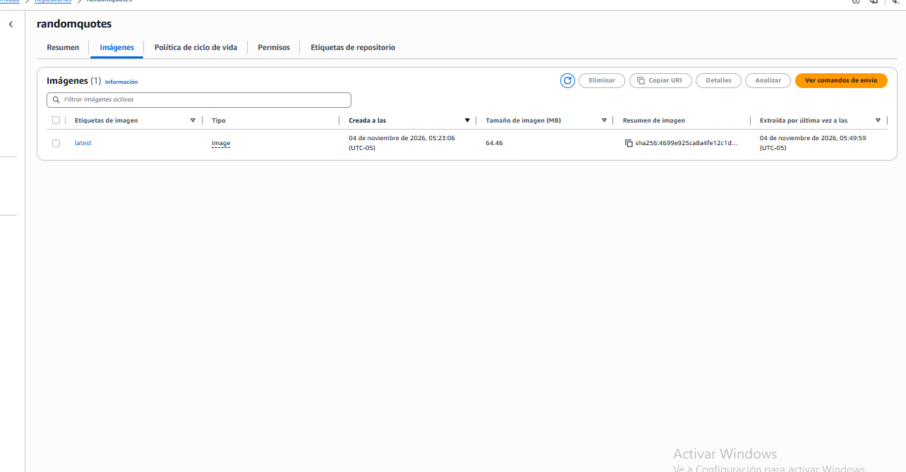
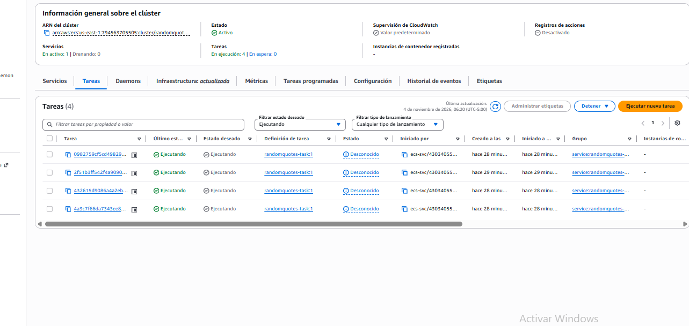
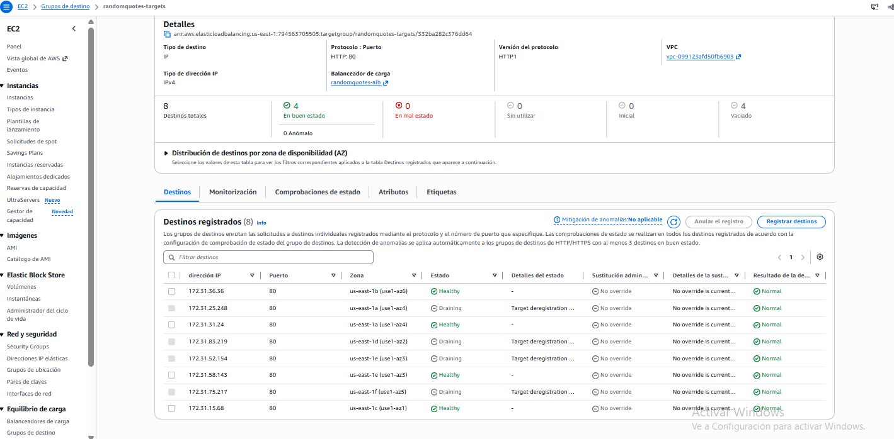
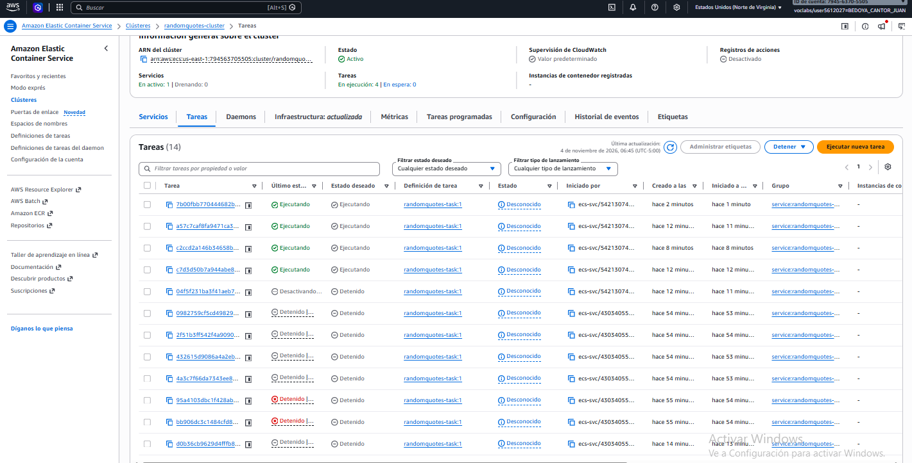
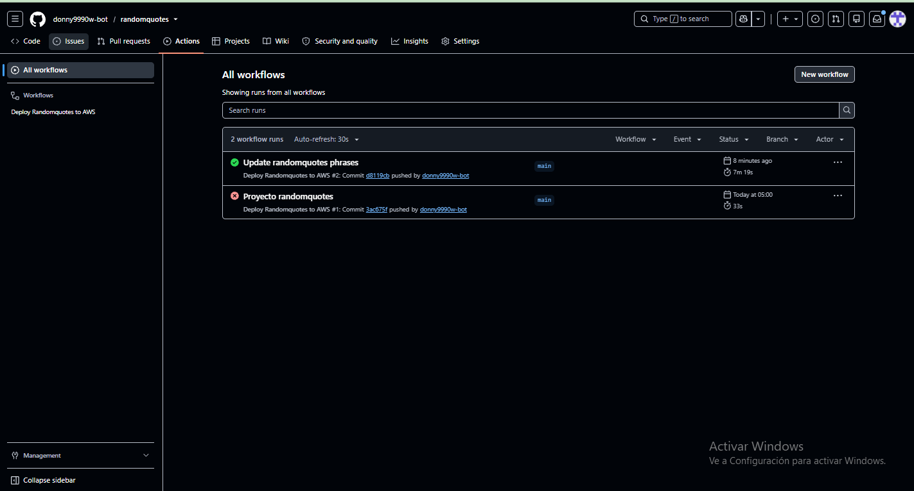
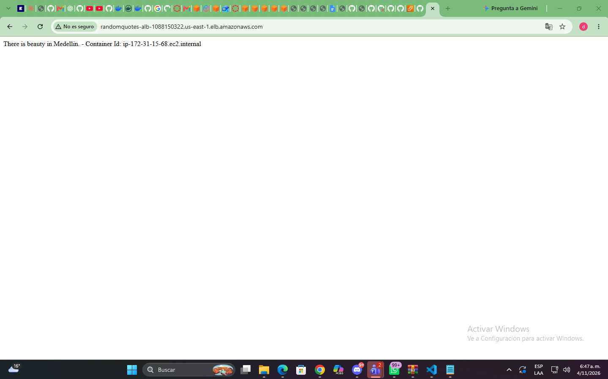

# randomquotes

App Express que muestra una frase aleatoria y el hostname del contenedor. Se despliega en AWS: GitHub Actions → ECR → ECS Fargate (4 tareas) detrás de un Application Load Balancer.

## Correr local

    docker build -t randomquotes .
    docker run --rm -p 8080:80 randomquotes

Abrir http://localhost:8080

## Despliegue

- Clúster: `randomquotes-cluster`
- Servicio: `randomquotes-service`, 4 tareas
- Cada push a `main` construye la imagen, la sube a ECR y fuerza un despliegue (`.github/workflows/deploy.yml`).
- Cuenta AWS Academy: no permite crear el proveedor OIDC ni el rol de la sección I.1 del tutorial, así que el workflow usa las credenciales temporales del laboratorio.

## Ajustes por AWS Academy

- En la Task Definition, usar `LabRole` como Task execution role.
- En GitHub → Settings → Secrets and variables → Actions, crear `AWS_ACCESS_KEY_ID`, `AWS_SECRET_ACCESS_KEY` y `AWS_SESSION_TOKEN` con los valores de AWS Details → AWS CLI.
- Esas credenciales vencen con la sesión del laboratorio: al abrir una sesión nueva hay que actualizar los tres secrets antes de hacer push.

URL del ALB: `PEGAR_DNS_DEL_ALB`

## Evidencias

## Evidencias

URL del ALB: http://randomquotes-alb-1088150322.us-east-1.elb.amazonaws.com

Contenedores observados: `ip-172-31-5-88.ec2.internal`, `ip-172-31-52-154.ec2.internal`, `ip-172-31-75-217.ec2.interna`

## Preguntas del tutorial

**¿Qué papel cumple el ALB?** Es el punto de entrada público y reparte las solicitudes entre las tareas saludables.

**¿Por qué se crea una tarea nueva?** Porque el servicio exige 4 tareas; al quedar 3, lanza una de reemplazo.

**¿Qué componente mantiene la cantidad deseada?** El servicio de ECS.

**¿Qué efecto tiene el health check?** El ALB solo envía tráfico a destinos saludables, y ECS reemplaza las tareas que fallan.

## Conclusiones

ECS mantuvo las 4 réplicas sin administrar servidores, y el ALB repartió el tráfico entre ellas. Un error real fue que el balanceador quedó con el grupo de seguridad de las tareas y sin regla IPv4, lo que hizo fallar los health checks hasta corregirlo.
